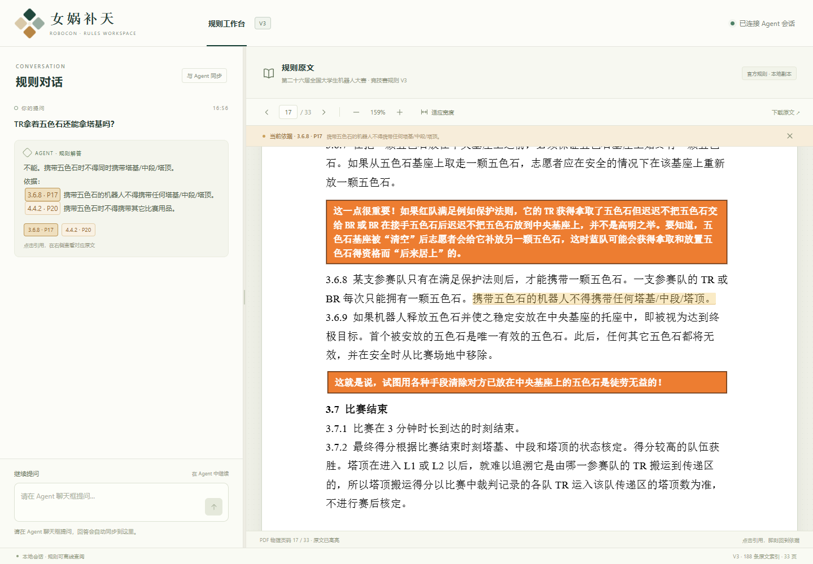

# 女娲补天 · 规则工作台

把 ROBOCON 女娲补天 V3 规则交给你自己的 Agent：左侧同步问答，右侧 PDF 自动翻页、高亮，所有规则随包离线分发。

**不填写 API Key、Base URL 或模型名。** 回答使用你已经在 Agent 中配置的模型；本项目只负责检索原文、计算和同步界面。



## 队员怎么用

把下面这句话发给支持 MCP 的 Agent：

> 请按 https://github.com/ye-ling-xuan/robocon-nuwa-rules/blob/main/AGENT_INSTALL.md 安装女娲补天规则 MCP，并加载仓库中的 SKILL.md。安装后帮我查：TR拿着五色石还能拿塔基吗？

Agent 首次检索时启动本地页面，并返回形如 `http://127.0.0.1:8765/?session=…` 的完整链接。打开一次即可；此后的问题仍在 Agent 聊天框里问，页面会持续追加问答并定位原文。点击 `[4.4.2 · P20]` 等引用，可以切换对应的页和高亮。

支持具备 **stdio MCP 工具调用**能力、能遵循服务器指令的宿主，例如 Claude Desktop、Cursor 及其它通用 MCP 客户端。品牌本身不代表支持 Sampling；以该连接实际声明的能力及授权为准。详细配置、路径和自动安装步骤见 [AGENT_INSTALL.md](AGENT_INSTALL.md)。

## 手动安装备用

安装 Python 3.11+ 和 [uv](https://docs.astral.sh/uv/getting-started/installation/)，将以下内容合并到宿主 MCP 配置，保留其它服务器：

```json
{
  "mcpServers": {
    "robocon-nuwa-rules": {
      "command": "uvx",
      "args": [
        "--from", "git+https://github.com/ye-ling-xuan/robocon-nuwa-rules",
        "robocon-nuwa-mcp"
      ]
    }
  }
}
```

Windows 的图形客户端如无法找到 `uvx`，应将 `command` 替换为该电脑上 `uvx.exe` 的绝对路径。第一次安装需要网络；规则查询和 PDF 渲染不依赖外网。

一条命令运行（默认 stdio，供 MCP 宿主启动）：

```sh
uvx --from git+https://github.com/ye-ling-xuan/robocon-nuwa-rules robocon-nuwa-mcp
```

本地界面预览（明确标记的示例问答，不会调用模型）：

```sh
uvx --from git+https://github.com/ye-ling-xuan/robocon-nuwa-rules robocon-nuwa-mcp --demo
```

完全离线运行可先在有网络时克隆仓库并安装到本地虚拟环境，然后将 MCP 的 `command` 指向虚拟环境中的 `robocon-nuwa-mcp` 可执行文件。宿主模型自身是否需要联网，取决于你原有的 Agent。

## 试试这些问题

| 问题 | 预期结论 / 原文依据（PDF 物理页码） |
| --- | --- |
| TR拿着五色石还能拿塔基吗？ | 不能；3.6.8 · P17、4.4.2 · P20 |
| L2 塔顶多少分？ | 满足计分条件时为 80 分；8.1.3 · P24 |
| TR 携带 4 个塔基会怎样？ | 超限携带犯规、强制重试，超限后拿取的物品取出禁用；6.5 · P23 |
| 这个塔算不算满足保护法则？ | 先补充各塔位置与状态；3.6.1 · P16，不凭空猜测 |
| 同分怎么判输赢？ | 按 9.2 · P26 的顺序破平 |
| 规则没有明确写的情况 | 规则未明确，请以原文/裁判为准。 |

## 能力和边界

- 七个工具：`search_rules`、`sync_answer`、`get_clause`、`open_ui`、`calc_score`、`judge_foul`、`check_protection`。完整输入和宿主工作流见 [SKILL.md](SKILL.md)。
- PDF.js、字体、CMaps、WASM、规则 PDF 和 188 个结构化条款/章节条目均随包提供，没有 CDN。PDF 包含 33 页，物理页码从 1 开始。
- SSE 支持迟打开、刷新、短暂断线及事件重放。会话只保存在内存中，每个 MCP 进程独立，最多保留 200 轮；退出宿主或进程后会话不保留。
- 支持单页阅读、前后翻页、缩放、适应宽度、拖动左右栏及手机上下布局。引用按 PDF 坐标定位；缺少坐标时，跨 textLayer 文本片段匹配原文。跨页条款提示并支持后续页高亮。
- 支持 Sampling 的宿主可在网页直接提问：网页向本地服务 POST，服务器通过现有 MCP 连接发送 `sampling/createMessage`，结果由 SSE 同步。没有任何外部模型 API 调用。不支持时输入框禁用，显示“请在 Agent 聊天框提问，回答会自动同步到这里。”
- 宿主可能拒绝独立的 Sampling 请求或要求人工批准；失败时回到 Agent 聊天框继续。声明支持 Sampling 不保证每次请求均获准。
- 计分工具按输入已满足放置、接触、颜色等计分条件估算，不自动重建现场。搬运分必须显式选 `mode=transport`；默认 `build` 只算安放分。颜色归属和两队总分仍须按原文核查。
- 犯规工具对明确的超限携带给出确定结论；否定、假设、先后动作或其它复杂情形返回需要澄清/裁判确认。保护法则使用同一时刻的状态，包含“此前已满足后永久满足”的条件。
- 服务拒绝不存在的条款、篡改的页码/引用/坐标和不一致的引用标签。对自由文本回答的事实含义仍需宿主依据原文核对；工具无法证明任意模型回答的语义正确。
- 当前验证覆盖真实 MCP stdio 协议、模拟宿主 Sampling 回调及真实浏览器；不声称已在 Claude Desktop / Cursor 的具体安装版本中实测。

## 常见问题

**界面打不开？** 保持宿主的 MCP 进程运行，使用工具最新返回的完整链接，包含 `session`。重启后旧会话链接会失效。调用 `open_ui` 获取新地址。服务只监听 `127.0.0.1`，手机布局用于本机浏览器模拟或同机小屏，不提供手机跨机器访问。

**8765 端口被占用？** 自动改用系统分配的空闲端口，使用返回的地址。也可在 MCP 参数中添加 `--port 8766`。不要固定假设一直是 8765。

**左侧一直“等待 Agent 回答”？** 宿主必须在回答后调用 `sync_answer`。加载 SKILL.md，或要求宿主遵循 MCP 的服务器指令。检索结果中的 `turn_id` 应原样传回。MCP 服务无法强制另一个 Agent 执行工具。

**高亮不准？** 页码是 PDF 物理页码。点击适应宽度后重试；更换规则 PDF 必须同时重新提取、校对数据并运行校验脚本，不能只替换 PDF。当前 V3 原文中的字体可能产生 PDF.js 的非致命字体警告，不影响已经核验的高亮。

**网页里不能输入？** 宿主未声明 Sampling，或上次请求被拒绝。继续在 Agent 聊天框提问即可同步，不需要另配模型。

## 开发、验证与规则更新

```sh
git clone https://github.com/ye-ling-xuan/robocon-nuwa-rules
cd robocon-nuwa-rules
uv sync --extra dev --frozen
uv run python scripts/validate_clauses.py
uv run pytest
uv run robocon-nuwa-mcp --demo
```

浏览器验收另见 [tests/README.md](tests/README.md)。依赖版本由 `uv.lock` 固定；发布轮子也包含全部规则和前端资源。
本次验证记录见 [docs/VALIDATION.md](docs/VALIDATION.md)。

当前数据来自仓库内的 **V3（修订日期 2026-11-05）**。`parse_pdf.py` 面向该 PDF 的排版，排除了小字号修订说明框；完整说明仍可在 PDF 中阅读。`2.n` 对应第 2 节术语表的第 n 行，和该 PDF 修订历史的编号方式一致。更新版本必须人工校对，不把自动提取稿当作已审定的新规则：

```sh
uv run python scripts/parse_pdf.py /path/to/new-rules.pdf
# 人工核对 clauses.json、page_map.json、页码标签、关联条款、计分表及关键语义
uv run python scripts/validate_clauses.py
uv run pytest
```

更新解析脚本中的版本/修订日期及排版参数，再运行以上命令。新规则改变携带上限、保护条件等语义时，必须同时更新相应工具与测试。计分表数值由条款内容解析，无法识别表格时停止计算。PDF 的 SHA-256 存在 page_map.json，错配时拒绝启动。

PDF.js 固定为 5.6.205，更新时从相应 npm 包运行 `python scripts/vendor_pdfjs.py /path/to/pdfjs-dist`，再执行浏览器验收。第三方资源及规则版权见 [THIRD_PARTY_NOTICES.md](THIRD_PARTY_NOTICES.md)。

```text
server/
  mcp_server.py       七个 stdio MCP 工具及宿主工作流
  rules.py           权威条款、关键词检索与引用校验
  state.py           会话、选中引用、SSE 重放
  service.py         界面同步及宿主 Sampling
  tools/             计分、犯规、保护法则
  ui/                本地 FastAPI、SSE、PDF.js 双栏界面
  data/              rules.pdf、clauses.json、page_map.json
scripts/             原文提取、数据校验、资源打包
tests/               单元、MCP 协议和浏览器验收
```
